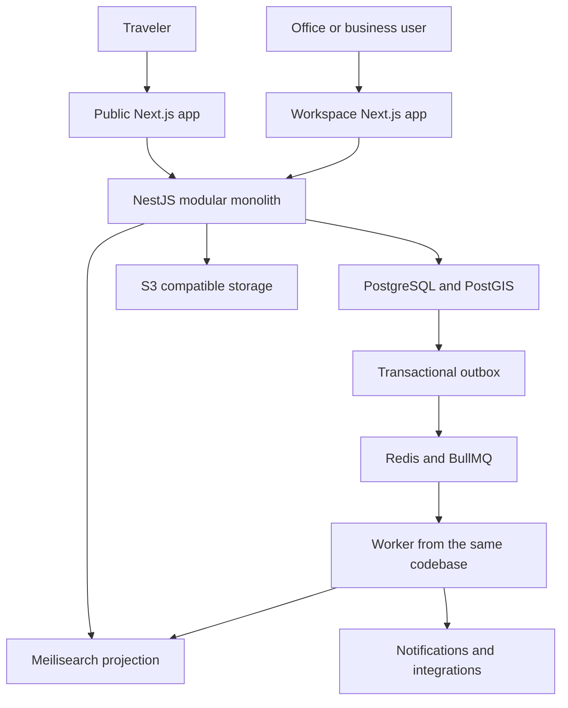
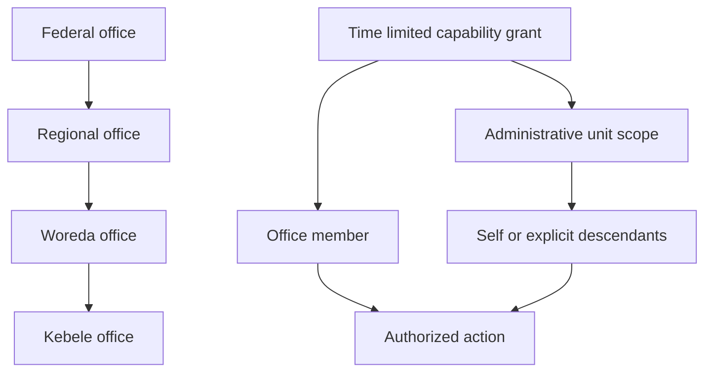
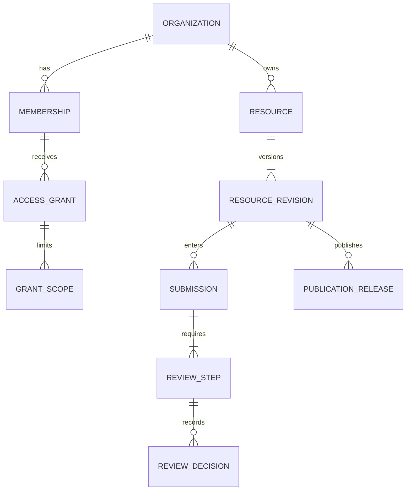
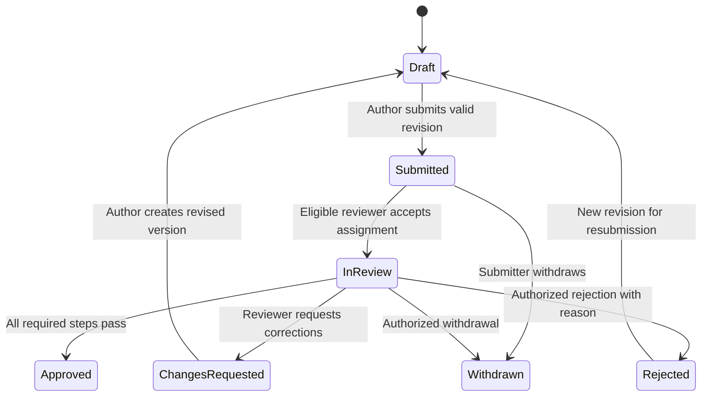
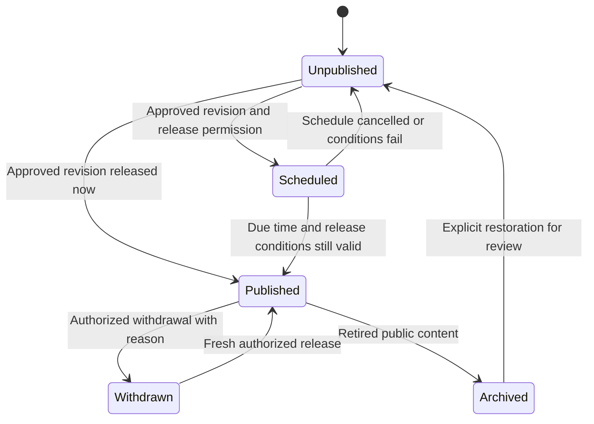

# EthioTour National Phase 0 Architecture Report

**Smart Tourism, Booking and Tourism Governance Platform**  
Prepared for Ermias Desta · 22 September 2026 · Version 0.1  
Status: **Proposed architecture awaiting approval**

This report defines a new national tourism product, its authorization boundaries, domain model, operating workflows, technical architecture and implementation sequence. It recommends beginning with a small, working official registry and jurisdiction-controlled publishing journey. Booking, payments and AI follow after those foundations can be demonstrated and tested.

This is an independent project. No application code, data, migrations, credentials, media, dependencies or configuration from the old `ethio-tour` project are used or required. A documentation-only local Git repository named `ethio-tour-national` has been initialized. A GitHub remote has not been created; its owner and visibility require confirmation in the approval package. Phase 0 contains documentation only. No application scaffold, database schema implementation or deployment is authorized by this report.

All government authority assignments below are **proposed product rules**, not statements of Ethiopian law. Wherever statutory authority, agency naming, delegation or policy is unresolved, the status is **Needs official confirmation**. Architecture approval by the project owner does not substitute for government authorization.

## Report guide

| Section | Deliverable |
| --- | --- |
| 1 | Product charter |
| 2 | Application architecture and technical decisions |
| 3 | Complete proposed role and permission matrix |
| 4 | Federal, Regional, Woreda and Kebele jurisdiction model |
| 5 | Domain entities and relationships |
| 6 | Approval and publication state machines |
| 7 | Tourism resource ownership rules |
| 8 | Public site information architecture |
| 9 | Workspace information architecture |
| 10 | Booking and payment architecture |
| 11 | Notification and review architecture |
| 12 | Search and recommendation architecture |
| 13 | Design system direction |
| 14 | Security, audit and operations model |
| 15 | Future data migration strategy |
| 16 | Phased implementation roadmap and confirmation register |
| 17 | Benchmark report for ten reference platforms |
| 18 | Exact Phase 1 recommendation and approval package |

## 1 Product charter

### Purpose and product promise

Help a traveler discover Ethiopia, understand a destination, make a realistic plan, reserve a service, travel with dependable information and leave a credible review. Help tourism businesses manage their own services. Help authorized offices maintain a traceable tourism registry within their jurisdiction.

The platform has two connected experiences: a public travel experience and an authenticated operations experience. They use the same approved records, while exposing different information and actions. Publishing a museum does not publish its verification documents. A national tourism report does not imply access to every traveler's personal information.

### Audiences and outcomes

| Audience | Main problem | Intended outcome |
| --- | --- | --- |
| Domestic and international travelers | Fragmented information and uncertain service availability | Find credible information and understand exactly what can be reserved |
| Private guides and businesses | Discovery, registration and booking work spread across channels | Maintain a verified profile, inventory and a clear reservation queue |
| Tourism offices | Inconsistent records and unclear responsibility | Scoped review, ownership, publication and accountable decisions |
| Institutions and community operators | Limited access to digital tourism distribution | Publish authorized experiences and information with fair representation |
| Platform operators | Abuse, operational failures and unclear support history | Trace incidents and recover without silently changing government decisions |

### Scope boundaries

The target platform includes all resource categories and workspaces requested in the brief. Delivery is staged. National capability means the data and authorization model can represent the country; it does not mean all destinations are populated or all offices are officially participating at launch.

Initial exclusions are airline inventory, visa issuance, a banking or wallet service, a new government identity provider, unrestricted public AI publishing, native mobile applications and microservices. Link to official visa services after link verification; do not represent EthioTour as an immigration authority. Tourism booking and official licensing remain separate activities.

Commercial assumptions include provider agreements, a support process, cancellation rules and possible booking commissions. Commission rates, fees, taxes, settlement responsibilities and contractual seller identity are undecided. Never seed invented financial results or present demonstration registrations as official verification.

### Measures of success

Measure visitor task completion, search success, planning saves, booking completion once available, cancellation clarity, support resolution and accessibility. Measure operator task completion, submission completeness, review age, publication freshness, data quality and isolation failures. Report real denominators, sample sizes and collection periods.

Proposed launch gates include zero known cross-scope disclosure defects, no unapproved public revisions, no overselling in concurrency tests, reconciled payment test journeys and usable keyboard flows. Traffic, conversion and revenue targets require a baseline; no top-ten ranking or market-share outcome is promised.

## 2 Application architecture and technical decisions

### Recommended shape

Use a TypeScript modular monolith in a pnpm monorepo. Two Next.js applications share components and generated API contracts: `public-web` serves travelers and `workspace-web` serves authenticated operations. One NestJS backend owns all domain rules. A worker process runs background handlers from that same backend codebase and release. The worker is a runtime separation for jobs, not a separately owned microservice.

PostgreSQL is authoritative for permissions, registry revisions, bookings and financial records. Redis, Meilisearch and rendered pages are disposable projections or delivery infrastructure. A Redis restart must never decide whether a room was sold or a user retains access.

### Technology decisions

| Concern | Recommendation | Boundary or qualification |
| --- | --- | --- |
| Public and operations web | Next.js, React and TypeScript | Server rendering for public content; interactive clients where needed |
| Backend | NestJS modules and versioned REST API | All authorization and state transitions enforced here, including calls from server-rendered pages |
| Database | PostgreSQL with PostGIS | Transactional integrity, spatial queries and row-level security |
| Data access | Drizzle ORM with reviewed SQL migrations | Use explicit SQL for RLS, spatial operations and locking; no production schema push |
| Jobs | Redis and BullMQ | Transactional outbox, retries and idempotent handlers |
| Styling | Tailwind CSS and semantic design tokens | Public and operations density differ without separate design systems |
| Accessible controls | shadcn/ui using Base UI primitives | Inspect every generated component; accessibility still requires testing |
| Animation | Motion for React | Restrained feedback; respect reduced motion |
| Maps | MapLibre GL JS | Separately procure or host tiles, glyphs and geocoding; routing is a separate dependency |
| Objects | S3-compatible storage | Separate public derivatives and private evidence; versioning and lifecycle policies |
| Search | Meilisearch | Published projections only initially; PostgreSQL remains the authority |
| Component workbench | Storybook | States, accessibility, both themes and language coverage |
| Browser tests | Playwright | Real browser journeys and multi-account isolation |
| Local and deployment packaging | Docker | Local Compose; hardened production containers, managed data services where practical |
| Automation | GitHub Actions | Quality gates, image builds and controlled deployment when authorized |
| Monitoring | Sentry and structured JSON logs | Redaction, correlation IDs and restricted telemetry access |

Current primary documentation confirms a shadcn Base UI path [T1], NestJS BullMQ integration [T2], PostgreSQL RLS [T3] and Drizzle PostGIS support [T4]. These support the selected direction. Exact runtime and dependency versions must be checked, compatibility-tested and pinned during Phase 1; this document does not promise that an untested collection of latest releases works together.

### Backend module boundaries

| Module | Owns | Calls or consumes |
| --- | --- | --- |
| Identity and Access | Identity mapping, sessions, memberships, grants, policy decisions | Geography and organization scopes |
| Geography | Administrative units, boundaries, ancestry and versions | Confirmed administrative reference data |
| Organizations | Offices, businesses, institutions and organization membership | Identity and geography |
| Registry | Resource identities, revisions, types, relationships and ownership | Geography, organizations, media |
| Governance | Submissions, workflow policies, assignments and decisions | Registry and access policies |
| Publication | Approved public snapshots, releases, withdrawals | Governance decisions |
| Media | Uploads, scanning, provenance, derivatives, private downloads | Access and object storage |
| Commerce | Offerings, pricing, availability, holds and bookings | Published resources and active suppliers |
| Payments | Attempts, verification, ledger, refunds and settlement | Commerce and payment adapters |
| Ticketing | Issued entitlements and redemption | Confirmed booking fulfillment |
| Trips and Discovery | Saved plans, search projections and recommendations | Published catalog and availability reads |
| Trust and Communication | Reviews, moderation, notifications and support cases | Booking outcomes and authorized recipients |
| Reporting and Audit | Scoped projections, audit queries and exports | Explicit domain events and audit records |

Modules access each other's application interfaces, not arbitrary repositories. Cross-module database transactions are allowed for operations that need atomicity, such as a booking confirmation plus its ledger event and outbox record. Import boundaries and code ownership must be checked in CI. No HTTP calls between modules inside the monolith.

### API and identity approach

Recommend a standards-based OpenID Connect identity provider for password handling, MFA, email verification and recovery. A locally runnable Keycloak instance is a candidate, not a mandated purchase or an assumed government integration. Its primary documentation describes standards-based application integration [T11]. Confirm operational burden in Phase 1. Organization and jurisdiction authorization always remain in EthioTour, not solely in identity-provider groups.

Use authorization-code flow with PKCE and server-managed sessions. Each web application uses secure, HttpOnly, host-only cookies; SSO occurs through redirects to the identity provider, not a cookie shared across all subdomains. NestJS validates access tokens and current membership/session revocation. Browser-held long-lived bearer tokens are excluded. Use CSRF and origin protection for cookie-authenticated mutations. Never trust an organization or jurisdiction passed from a browser without resolving it against active grants.

Next.js acts as presentation and a thin server-side API client or BFF. It does not connect directly to the application database or implement a second approval engine. All REST requests use runtime input validation; TypeScript types alone are not validation. OpenAPI describes DTOs and generates clients. Return stable error codes, field errors and request IDs; use cursor pagination and optimistic version checks. Do not expose persistence entities as public API responses. Next.js security guidance reinforces treating server actions as accessible endpoints requiring authorization [T5].

Public content may be cached only as an approved projection. Workspace responses use private, non-shared caching or no-store. Separate applications reduce accidental sharing of public and private rendering paths; they do not replace API authorization.

## 3 Complete proposed role and permission matrix

### Interpretation and rule of evaluation

The matrices define the entire proposed capability envelope. An unlisted action is denied. Business type determines workspace modules; it does not automatically grant every employee owner privileges. Bureau level describes organizational position; editors, reviewers, publishers, access managers and analysts receive explicit capability bundles.

**Allow an operation only when one valid grant supplies the required capability and covers the record scope, the actor has the required relationship, the record is in an allowed state, and all restrictions pass.** Never take a review capability from a Woreda A grant and combine it with an unrelated read-only grant for Woreda B.

In the tables: **Public** means published information visible to everyone; **Own** means the user's records; **Org** means explicitly assigned organization or branch records; **Geo** means assigned geographic scope only; **Case** means an assigned, purpose-limited case; **Conditional** requires a separately approved capability or mandate; **Denied** means no default permission. No assignment means no private workspace data.

### Government and platform permissions

All government powers in this table are **Needs official confirmation** before production enablement. Federal access to descendant records requires an explicit grant with descendant coverage. A senior title alone does not create access.

| Capability | Federal Bureau | Regional Bureau | Woreda Office | Kebele Office | Platform Administrator |
| --- | --- | --- | --- | --- | --- |
| Read public catalog | Public | Public | Public | Public | Public |
| Read private registry metadata | Geo with grant | Geo with grant | Geo with grant | Geo with grant | Case only |
| Create or edit registry drafts | Owned or delegated resources in Geo | Owned or delegated resources in Geo | Owned or delegated resources in Geo | Owned or delegated resources in Geo | Denied by default |
| Submit resource revision | Same scope as edit | Same scope as edit | Same scope as edit | Same scope as edit | Denied |
| Review or request changes | Geo, assigned workflow step | Geo, assigned workflow step | Geo, assigned workflow step | Conditional local verification step | Denied |
| Approve or reject | Geo and policy mandate | Geo and policy mandate | Conditional policy mandate | Conditional policy mandate | Denied |
| Publish or schedule publication | Geo and publisher mandate | Conditional publisher mandate | Conditional publisher mandate | Conditional publisher mandate | Denied |
| Withdraw official content | Geo and withdrawal mandate | Conditional mandate | Conditional mandate | Conditional mandate | Technical quarantine only, with case and audit |
| Read verification evidence | Case, permitted evidence classes | Case, permitted evidence classes | Case, permitted evidence classes | Case, permitted evidence classes | Case only; no blanket access |
| Verify a provider or guide | Assigned case and confirmed mandate | Assigned case and confirmed mandate | Conditional mandate | Conditional mandate | Account-security checks only |
| Decide licensing or legal eligibility | Conditional statutory mandate | Conditional statutory mandate | Conditional statutory mandate | Conditional statutory mandate | Denied |
| Transfer registry stewardship | Confirmed transfer mandate | Conditional within mandate | Conditional within mandate | Request only by default | Technical execution of approved transfer only |
| Edit geographic reference data | Dedicated curator and approved change | Propose correction | Propose correction | Propose correction | Technical execution, no policy decision |
| Assign staff capabilities | Dedicated access manager, bounded grant | Dedicated access manager, bounded grant | Conditional bounded grant | Conditional bounded grant | Provision identity; no self-approved Bureau power |
| View tourism reports | Geo, approved aggregate measures | Geo, approved aggregate measures | Geo, approved aggregate measures | Geo, approved aggregate measures | Operational health only by default |
| Read traveler booking PII | Denied unless authorized Case | Denied unless authorized Case | Denied unless authorized Case | Denied unless authorized Case | Support Case only |
| View audit history | Geo and permitted field classes | Geo and permitted field classes | Geo and permitted field classes | Geo and permitted field classes | Security/technical audit and assigned cases |
| Export data | Separate export grant, same scope | Separate export grant, same scope | Separate export grant, same scope | Separate export grant, same scope | Separate case-bound export grant |
| Refund or pay suppliers | Denied by Bureau role | Denied by Bureau role | Denied by Bureau role | Denied by Bureau role | Dedicated finance capability and dual control |
| Suspend platform account | Request through Case | Request through Case | Request through Case | Request through Case | Security capability; cannot rewrite official license status |
| Change audit history | Denied | Denied | Denied | Denied | Denied |

Technical quarantine can immediately prevent dangerous media or abusive content being served. It records a distinct operational reason and does not pretend to be a government rejection. Restoration needs a separate authorized decision.

### Traveler and commercial permissions

| Capability | Tourist | Private Tour Guide | Hotel | Restaurant | Transportation | Event Organizer | Tourism organization or institution |
| --- | --- | --- | --- | --- | --- | --- | --- |
| Read public resources | Public | Public | Public | Public | Public | Public | Public |
| Manage personal profile and trip plans | Own | Own in traveler context | Own in traveler context | Own in traveler context | Own in traveler context | Own in traveler context | Own in traveler context |
| Reserve or buy | Own | Own in traveler context | Own in traveler context | Own in traveler context | Own in traveler context | Own in traveler context | Own in traveler context |
| Edit supplier profile | Denied | Own guide profile | Org | Org | Org | Org | Org |
| Submit registration and evidence | Denied | Own | Org | Org | Org | Org | Org |
| Create listing revisions | Report correction only | Own services | Org accommodations | Org restaurants | Org vehicles and services | Org event editions | Delegated or owned resources |
| Self-approve official verification | Denied | Denied | Denied | Denied | Denied | Denied | Denied |
| Self-publish official listing revision | Denied | Denied | Denied | Denied | Denied | Denied | Denied unless separate confirmed mandate |
| Manage price and availability | Denied | Assigned guide offerings | Assigned rooms and rate plans | Assigned slots and capacity | Assigned fleet and transfers | Assigned sessions and ticket stock | Assigned offerings where commerce enabled |
| Accept or decline reservations | Denied | Own assigned service bookings | Org assigned bookings | Org assigned bookings | Org assigned bookings | Org assigned bookings | Assigned offering bookings |
| See booking customer details | Own booking | Minimum fulfillment fields | Minimum fulfillment fields | Minimum fulfillment fields | Minimum fulfillment fields | Minimum fulfillment fields | Minimum fulfillment fields |
| Cancel or request refund | Own, policy applies | Request/execute within grant and policy | Same | Same | Same | Same | Same |
| Override refund decision or pay out | Denied | Denied | Denied | Denied | Denied | Denied | Denied |
| Read balances and statements | Own receipts | Own finance grant | Org finance grant | Org finance grant | Org finance grant | Org finance grant | Org finance grant |
| Write verified traveler review | Own eligible fulfillment | Own eligible purchase, no conflict | Same | Same | Same | Same | Same |
| Reply to reviews | Denied | Own listing | Org listing | Org listing | Org listing | Org listing | Assigned listing |
| Remove negative reviews | Denied | Denied | Denied | Denied | Denied | Denied | Denied |
| Invite organization employees | Denied | Only if registered as staffed Org | Org access-manager grant | Same | Same | Same | Same |
| View reports or exports | Own data download | Own assigned data | Org assigned data | Same | Same | Same | Same |
| View other suppliers' private records | Denied | Denied | Denied | Denied | Denied | Denied | Denied |

An anonymous visitor can browse published resources and maintain a temporary local plan, but cannot access a private workspace, pay or post a verified review. Traveler login is required for the initial booking product; guest checkout is a later explicit decision.

Business staffing uses separate manager, listing editor, reservation agent, finance viewer and team-manager bundles. A reservation agent cannot change payout details. For institutions, content-only, museum operator and experience provider are capabilities within the organization workspace, not automatic government privileges.

### Specialized sensitive capabilities

| Capability bundle | Allowed responsibility | Mandatory restriction |
| --- | --- | --- |
| Bureau reviewer | Decide assigned review steps | Cannot decide a submission the actor authored or materially edited |
| Bureau publisher | Release an approved revision | Must reference the exact approved revision; no editing during release |
| Access manager | Grant existing approved bundles | Cannot grant outside own delegation ceiling or approve own elevated access |
| Support agent | Investigate assigned customer case | Time-limited fields and scope; no silent impersonation |
| Finance operator | Reconcile and propose refund or payout | Cannot approve own payout proposal or change historical ledger entries |
| Finance approver | Approve eligible financial action | Independent approver; policy limits and strong authentication |
| Trust moderator | Apply published review/content rules | No commercial suppression; reason and appeal trail required |
| Security operator | Revoke sessions and quarantine threats | Does not acquire Bureau approval or finance authority |
| Auditor | Read authorized immutable evidence | No operational mutation; export is an additional grant |
| Emergency operator | Time-limited incident intervention | Strong authentication, recorded reason, expiration and independent review |

These are capability bundles assigned to authorized people, not additional public account types. Enforcement includes API objects, list counts, charts, exports, uploaded files, notification recipients, search facets, scheduled jobs and direct URL access. Hiding navigation alone is never enforcement.

## 4 Jurisdiction model

### Government hierarchy and geographic hierarchy

The requested administrative workflow is Federal Tourism Bureau → Regional Tourism Bureau → Woreda Tourism Office → Kebele Tourism Office. Treat those names and authority relationships as requested working labels. Exact official names, city administrations, zones, special Woredas and other exceptions are **Needs official confirmation**. Do not force every real place into an invented four-level structure.

Keep `AdministrativeUnit` separate from `Office`. Units describe geography; offices describe organizations and mandates. A configurable unit type and effective-dated parent relationship accommodate confirmed exceptions without changing a hard-coded role enum. A closure table records ancestor/descendant relationships for fast scope checks. A tree must be acyclic, and every effective unit has at most one administrative parent in the selected hierarchy version.

This diagram is a proposed product hierarchy, not a legally verified organization chart.

### Grant structure and active context

Each grant links a membership, permission bundle, organization, one or more scope entries, descendant coverage flag, resource-type restrictions, validity period, issuing authority and policy version. Revocation and suspension take precedence over a grant. Keep resource field restrictions separate from geographic coverage.

Users can hold multiple memberships. The workspace selects one active organization and one permitted operating scope, visibly shown in the header. Switching is server-validated and audited, invalidates old data queries and never expands permissions. A request is evaluated against that explicit context, not the unrestricted union of every role the user has ever held.

Public material is public nationwide, even to an officer outside that area's private workspace. This is not a scope breach. Drafts, evidence, private owner records and internal decisions remain restricted.

### Spatial relationships and exceptions

Administrative authority is established by confirmed assignments, not simply by testing where a coordinate falls. PostGIS validates positions and supports discovery. Boundary overlaps, disputed assignments and missing polygons enter a correction queue; a point on a line must not grant two offices authority automatically. Validate geometries and record their source, validity dates and resolution. Spatial predicates have boundary semantics that must be chosen deliberately [T6].

A resource has one primary administrative unit and may have explicit coverage units. A guide's operating area and a transport route may span several areas. These are service coverage, not permission to edit official records in each area. A cross-region event or route gets an explicit lead stewardship organization and a confirmed review policy; absent that policy, the action is blocked for resolution rather than sent to an invented national approver.

Destination is an editorial tourism place and may cross administrative borders. It is not the security tenant. Boundary reorganization does not silently transfer ownership or rewrite earlier decisions. Version the geography, evaluate present access against current approved assignments and retain historical scope snapshots on decisions and bookings.

### Enforcement

Use centralized NestJS policy evaluation and scoped repositories, with PostgreSQL RLS as defense in depth on private scoped tables. Use a non-owner, non-superuser application database role without `BYPASSRLS`; maintain a separate migration role. RLS needs appropriate `USING` and `WITH CHECK` policies, and child tables need policies too. PostgreSQL documents owner and superuser bypass behavior [T3].

Set request context transaction-locally so pooled connections cannot carry one office's context into another request. Only trusted server code supplies context. A missing context must deny private queries. Public reads use limited projections and a dedicated read path. Validate foreign keys and normalize constraint errors so attempted inserts cannot expose hidden record existence. An RLS policy is not protection against unrestricted database administrator access.

Jobs re-resolve permission at execution; exports re-check authorization at download. Revoking a grant invalidates access immediately at the API authority check and expires or invalidates scoped caches. Reporting queries apply the same scope as detail queries, including totals and facets.

## 5 Domain entities and relationships

### Domain catalog

The following is the target logical model, not a request to create all tables in Phase 1.

| Domain | Entities | Key relationships and constraints |
| --- | --- | --- |
| Identity | User, ExternalIdentity, UserSession, SecurityEvent | User has many identities/sessions; provider subject is unique within issuer |
| Access | RoleTemplate, Permission, RolePermission, Membership, AccessGrant, GrantScope | User joins organizations through membership; grants always retain membership and scope together |
| Geography | AdministrativeUnit, UnitParentVersion, UnitClosure, BoundaryVersion | Units have effective ancestry; boundaries carry provenance and approval |
| Organizations | Organization, OfficeMandate, OrganizationBranch, OrganizationContact | Offices, companies, institutions and sole guides are organization kinds; branches can be scoped independently |
| Registry core | Resource, ResourceRevision, ResourceTranslation, ResourceDestination, ResourceCoverage | Stable identity has immutable revisions and one required primary destination context |
| Resource types | Destination, Attraction, HeritageSite, Museum, EventSeries, EventEdition, Accommodation, Restaurant, TransportService, GuideProfile, LocalExperience, Announcement, TourismDocument | Typed records attach one-to-one to matching resource identity; event edition belongs to series |
| Resource connections | ResourceRelation, OwnershipAssignment, StewardshipAssignment, OwnershipTransfer | Related resources share identity links without duplicating legal ownership |
| Media | MediaAsset, MediaRevision, MediaAttachment, UploadScan, MediaRights | Attachments distinguish public media from private evidence; rights and scan state are mandatory |
| Governance | WorkflowPolicyVersion, Submission, ReviewStep, ReviewAssignment, ReviewDecision, VerificationCase, VerificationEvidence | Decisions reference exact immutable revision, actor grant and policy version |
| Publication | PublicationRelease, PublicResourceProjection, PublicationRestriction | Release references approved revision; withdrawal and quarantine are independent controls |
| Commercial catalog | Offering, OfferingVersion, RatePlan, PriceRule, CancellationPolicyVersion | A published resource may have several sellable offerings; policies are versioned |
| Inventory | InventoryUnit, InventoryBucket, AvailabilityRule, InventoryBlock, Hold, HoldAllocation | Resource-specific capacity models; hold expiry and status stored in PostgreSQL |
| Reservations | Booking, BookingItem, BookingGuest, BookingAllocation, BookingTransition, CancellationRequest | Traveler has many bookings; initial booking belongs to one supplier; amounts and policies snapshot |
| Payments | PaymentAttempt, PaymentEvent, PaymentAllocation, Refund, Dispute | Unique gateway references and event IDs; refund cannot exceed eligible collected amount |
| Accounting | LedgerAccount, LedgerTransaction, LedgerEntry, Settlement, Payout, ReconciliationCase | Posted entries balance per currency and are reversed, never overwritten |
| Tickets | TicketType, Ticket, Redemption | Tickets derive from confirmed entitlements; one successful redemption per permitted use |
| Planning | Trip, TripDay, TripItem, TripShareGrant | Private by default; saved content retains reference and freshness state |
| Trust | ReviewEligibility, Review, ReviewRevision, ReviewReply, ModerationCase, Appeal | Eligibility tied to fulfillment; prevent supplier self-review and duplicate eligibility use |
| Communication | Notification, NotificationDelivery, Preference, TemplateVersion, SupportCase | Delivery attempts are separate from domain outcome and from in-app read state |
| Infrastructure | OutboxEvent, ConsumerReceipt, IdempotencyRecord, AuditEvent, ExportJob, ImportBatch, SourceMapping | Deduplication and recovery; audit and imported provenance are durable |

### Registry common contract

Every resource identity has a type, owner organization, stewardship organization, primary destination context, primary administrative unit, coverage references, lifecycle status, current draft revision, current public release if any, timestamps and row version. Every revision has localized content, source attribution, author, evidence/media links, completeness checks and a content hash. Review and publication history are linked entities, not an editable string field.

For a destination resource, the primary destination context is the destination itself. For a national announcement or document, it is an explicit national tourism context representing Ethiopia, not a fake Kebele or an absent location. Other resources choose a real primary destination and may have secondary destination links. A private guide's residential address is not their public destination marker.

Media assets that are only attachments inherit the owning resource's destination and authorization context through the attachment. A standalone public media collection is a tourism resource with its own revision and release. Private verification documents are never transformed into public tourism documents merely by attachment.

Use typed subtype tables for operational attributes, including event dates, museum opening hours and accommodation details. Avoid one unvalidated JSON object for every resource type. JSON may hold bounded, versioned editorial blocks or snapshots; operational rules require schema constraints and validated types.

### Important cardinalities

Commercial resources link to offerings; offerings link to inventory; booking items reference offering snapshots and allocations. Payment attempts belong to bookings but remain separate records because retries and refunds do not create a new tourism resource or erase the original booking.

### Shared data rules

Use opaque generated identifiers and stable human-facing references. Record instants in UTC and retain the relevant IANA timezone, normally `Africa/Addis_Ababa` for local services. Store hotel nights as local dates, not midnight UTC instants. Label Gregorian and Ethiopian calendar displays explicitly; preserve original calendar input and validate conversion. Event occurrence dates require an actual edition, not a recurring festival name interpreted as a confirmed date.

Money uses integer minor units and an ISO currency code. Never use floating point for accounting or sum different currencies. Use fixed precision for tax or rate calculation before an explicit rounding rule. Keep public star classification, government verification, traveler rating and platform quality labels distinct.

## 6 Approval and publication state machines

### Revision review lifecycle

The arrows back to Draft represent creation of a new revision; old evidence and decisions remain immutable. Submission freezes its content hash and workflow policy version. A new edit cannot inherit a prior approval. Approval attaches to a revision, not indefinitely to the resource identity.

### Publication lifecycle

Lifecycle status, review status, publication state and commercial availability are separate. A restaurant can remain a published place while reservations are temporarily unavailable. A provider can be commercially suspended without deleting historical bookings. A tourism resource can be archived without deleting audit or accounting records.

| Transition or action | Required actor and guard | Recorded result |
| --- | --- | --- |
| Submit | Owner/delegated editor; scope valid; required fields/evidence complete | Immutable revision and pinned policy |
| Claim review | Assigned reviewer; capability valid; no author conflict | Review assignment with time and scope |
| Request changes or reject | Reviewer mandated for that step | Reason code, explanation, evidence references |
| Approve step | Different person from revision author; evidence still valid | Step decision and content hash |
| Approve submission | Every required step passed; no blocking conflict | Approval record, not automatic public release |
| Publish | Explicit publisher capability and approved current revision | Release and public projection atomically updated |
| Publish scheduled | Policy still active, approval valid, resource not restricted | Release or blocked job with explanation |
| Edit published resource | Authorized editor | New draft; previous release remains public |
| Withdraw | Authorized withdrawal mandate or separate security quarantine | Denial marker immediately stops serving; cache/index removal follows |
| Transfer ownership | Confirmed transfer authority and recipient acceptance | Effective-dated assignment; historic decisions retained |
| Appeal | Applicant within policy window | Separate case; no overwriting original decision |

The initial demonstration policy is one independent reviewer followed by an explicit publish action, with self-approval prohibited. The publisher may be the reviewer if that demonstration policy permits it. Whether government requires separate reviewer and publisher people, multiple office levels, appeal deadlines or emergency powers is **Needs official confirmation**. Do not send every submission through all four levels by default.

Provider registration follows Draft → Submitted → Evidence review → Changes requested / Verified / Rejected. Credential expiry or suspension changes eligibility independently. Platform account access, official verification, listing publication and permission to accept bookings each have their own state. A verified document is not a legal license unless the relevant authority has confirmed that meaning.

Public eligibility requires a released approved revision, a permitted lifecycle status, no active publication restriction and a public field projection. Apply it to pages, search, map, sitemaps, feeds, recommendations, social metadata and media. Commerce additionally requires an active supplier, eligible offering and reservable inventory.

## 7 Tourism resource ownership rules

Record three separate relationships: **legal or asserted owner**, **registry steward**, and **current editor or operator**. An organization can hold several relationships, but one must never be inferred from another. Until legal ownership is verified, label it as asserted ownership. Registry stewardship does not transfer ownership of a heritage site or business.

| Resource | Proposed owner/operator record | Stewardship and change rules |
| --- | --- | --- |
| Destination | Designated public organization | Editorial steward assigned by confirmed mandate; may cover multiple units |
| Attraction or heritage site | Confirmed institution, community, public or private organization | Record custodianship separately; culturally sensitive facts need evidence |
| Museum | Museum institution or owning organization | Authorized institution edits; mandated office reviews official publication |
| Cultural event or festival | Organizer for the specific edition; series custodian separately | Each edition has dates, venues and accountable organizer; no inherited annual approval |
| Accommodation | Registered supplier and branch | Supplier manages commercial inventory; official claims follow review |
| Restaurant | Registered supplier and branch | Menu/operating data under supplier grant; official listing revision under publication rules |
| Transportation | Supplier of the service | Fleet ownership/lease evidence separate; coverage does not grant Bureau access |
| Private guide | Sole-provider organization linked to guide identity | Public professional details distinct from confidential identity evidence |
| Local experience | Operator, institution or community organization | Participant consent and rights to representation recorded where relevant |
| Announcement | Issuing authorized office or organization | Audience, geography, expiry and issuing authority required |
| Tourism document | Issuing organization | Classification, validity and superseding version recorded |
| Public media | Rights holder plus licensed platform use | Creator credit, license, permission, expiry and linked destination required |

Each resource has exactly one accountable active owner assignment and one lead steward at a time. Additional collaborators receive limited grants. Ownership transfer records approvals, effective date and reason; it never rewrites older revision authors or lets the former owner retain unneeded access.

Branches own operational inventory through their organization relationships. Parent-company staff need explicit branch grants. A hotel editor may propose a location correction but cannot move a property to a different jurisdiction to escape review. Geographic, owner, credential and other protected changes are separately reviewed.

Prices, inventory and availability use commercial permissions and validation, not full Bureau editorial review on every update. Descriptive or credential changes use resource revisions. Keep this boundary visible so governance does not block ordinary business operations.

## 8 Public site information architecture

### Navigation and page families

Primary navigation: **Explore Ethiopia, Things to do, Places to stay, Plan your trip, Events**. Search and map are persistent discovery actions. Guides, food and transport are visible in relevant navigation and destination pages. Keep official services and provider sign-in accessible without making government hierarchy the travel navigation.

| Family | Proposed routes | Main content and action |
| --- | --- | --- |
| Home | `/[locale]` | Ethiopian stories, trip entry points, search, seasonal content and genuine trust signals |
| Destinations | `/[locale]/destinations`, `/destinations/[slug]` | Story, practical facts, attractions, stays, guides, events and map |
| Discovery | `/[locale]/search`, `/map` | Shareable query, category filters, list/map parity, clear sorting |
| Experiences | `/[locale]/attractions`, `/heritage`, `/museums`, `/experiences` | Searchable listings and detailed published resource pages |
| Services | `/[locale]/stays`, `/restaurants`, `/transport`, `/guides` | Type-appropriate filters, profiles, policies and availability |
| Events | `/[locale]/events`, `/festivals`, `/events/[slug]` | Edition dates, venue, access requirements and tickets when offered |
| Travel essentials | `/[locale]/plan`, `/travel-information` | Transport, etiquette, accessibility, calendars and verified official links |
| Trip planner | `/[locale]/trips/[id]` | Editable days, route assumptions, budget estimate and saved options |
| Purchase | `/[locale]/checkout/[id]`, `/bookings/[reference]` | Quote, explicit policy, payment state, receipt and support |
| Traveler account | `/[locale]/account` | Trips, bookings, tickets, reviews, notifications and security |
| Official information | `/[locale]/announcements`, `/documents` | Issuer, scope, version, publication date and expiry |
| Help and trust | `/[locale]/help`, `/accessibility`, `/privacy`, `/terms` | Support, reporting, cancellations and transparent platform responsibilities |

Routes in each family inherit the locale prefix. These paths are proposals, not created pages.

### Journey requirements

| Stage | Visitor needs | Required interface behavior |
| --- | --- | --- |
| Discover | A meaningful place or experience to consider | Story-led entry points, useful search and map/list choice |
| Understand | Credibility, access conditions and fit | Owner/source, verification meaning, last checked date, inclusive practical facts |
| Plan | Feasible sequence, travel time and cost | Editable itinerary, date conflicts, approximate routing clearly labeled |
| Reserve or buy | Real capacity and a comprehensible commitment | Quote expiration, total cost, cancellation deadline and explicit confirmation |
| Travel | Accessible tickets, contacts and updates | Readable itinerary, ticket access, service changes and support |
| Review | A fair way to report the experience | Eligibility explanation, review form, reply/report/appeal paths |

A destination page should move from emotional introduction to essential facts, things to do, places to stay, guides, food, transport, events and an editable itinerary suggestion. Put temporary advisories above promotional content when a confirmed issuer and current validity warrant it.

Filter vocabularies depend on category. Hotels need dates, guests, total price and facilities. Restaurants need time, party size and dietary information. Guides need languages, expertise and operating area. Transport needs pickup/drop-off, seats and driver option. Events need confirmed date, venue and ticket availability. Do not show a hotel-room filter on every resource.

Every detail page distinguishes “Information only,” “Request to book,” “Instant confirmation” and “External booking.” Unavailable inventory is not “sold out” unless actual inventory proves that. No fabricated scarcity, fake ratings, government seals or unverified star classifications.

Start with English and Amharic interface architecture, subject to content staffing confirmation. Local-language names, transliteration and future language expansion are first-class fields. Publish only reviewed translations; show a clear fallback language when translation is missing. Do not let untranslated text hide important cancellation or payment obligations.

## 9 Workspace information architecture

A single operations application provides separate role-aware workspaces. It uses the active membership, organization and jurisdiction to load permitted modules. Distinct navigation does not require a separate application for each role.

| Workspace | Primary navigation | Default dashboard and principal queue |
| --- | --- | --- |
| Federal Bureau | Overview, national registry, assigned reviews, publications, offices, reports, audit | Assigned national tasks, data coverage and overdue reviews within authorized scope |
| Regional Bureau | Overview, regional resources, submissions, providers, guides, announcements, reports, audit | Regional review backlog and content freshness |
| Woreda Office | Overview, local registry, assigned verification, submissions, events, reports | Local completeness and assigned work |
| Kebele Office | Overview, local submissions, corrections, assigned checks, announcements | Drafts needing completion and returned submissions |
| Platform Administrator | System health, access requests, support, moderation, security, integrations, audit | Failures and operational exceptions; finance only with separate capability |
| Tour Guide | Overview, profile, credentials, services, availability, bookings, earnings, reviews | Upcoming assignments, pending requests and credential expiry |
| Hotel | Overview, property, rooms, rate plans, availability, reservations, finance, team | Arrivals/departures, occupancy data and pending booking work |
| Restaurant | Overview, profile, menu, service periods, capacity, reservations, finance, reviews | Today's reservations and capacity conflicts |
| Transportation | Overview, company, fleet, availability, transfers, bookings, finance, team | Pickups, vehicle allocation and maintenance blocks |
| Event Organizer | Overview, events, sessions, ticket types, stock, attendees, redemption, finance | Upcoming events, ticket exceptions and gate readiness |
| Organization or institution | Overview, resources, documents, submissions, experiences, staff | Owned-resource quality and assigned operating tasks |
| Tourist account | Trips, bookings, tickets, reviews, notifications, account | Next trip and actions requiring traveler attention |

Bureau workspace headers show office, geographic context and active capability. Show “No jurisdiction assigned” with a request-assignment action when appropriate, never a national fallback. Jurisdiction switching appears only for available assignments. Forms show their owning organization and destination before submission.

Review detail uses a revision comparison, evidence checklist, decision history and an explicit approve/request-changes/reject action with reason. Version conflicts require reload and reconciliation, not last-write-wins. A success message appears only after committed server state; the updated state should survive a refresh.

Tables support meaningful filters, saved views, bulk selection with per-item authorization, keyboard access and scoped export. Dashboard counts drill into the same scoped records. Loading, zero matching results, no records yet, no access, dependency failure and completed action each get different messages and recovery actions.

## 10 Booking and payment architecture

### Commercial boundary

Resource information is not inventory. A hotel resource describes a property; an offering describes what is sold; an inventory model determines when it can be sold; a booking snapshots the agreement. The first commerce release supports one supplier and one service category per booking. A trip may contain multiple independent bookings. A cross-supplier cart is deferred until partial failure and refund behavior are explicitly designed.

| Service | Inventory model | Principal constraints |
| --- | --- | --- |
| Hotel | Room type by local night; optional physical room allocation | Capacity for every night, guest occupancy, rate restrictions and closed dates |
| Restaurant | Service interval and capacity/table allocations | Party size, duration, turnaround time and overlapping reservations |
| Transport | Vehicle/time interval or departure seat stock | Maintenance, pickup buffer, seats, driver allocation and no overlapping exclusive use |
| Guide | Guide/time interval and optional group capacity | Travel buffer, permitted service area and conflicting assignments |
| Event | Edition/session/ticket-type capacity | Sales window, quantity limit, cancellation and unique entitlement issuance |
| Museum or experience | Timed slot or dated admission inventory | Venue capacity, opening hours and any confirmed eligibility rules |

Use PostgreSQL locking and constraints for allocation. For nightly or pooled stock, lock every required bucket in deterministic order and reserve all units in one transaction. For exclusive assets, use overlap constraints or locked scheduling logic backed by tests. Holds are durable database rows with `expires_at`; Redis timers only help release them. A cleanup job failure must not make an expired hold purchasable or leave it authoritative forever.

### Reservation flow

Instant booking: validate service eligibility → calculate expiring quote → create inventory hold → start payment or accepted pay-later path → verify required financial condition → atomically confirm allocation → issue ticket/confirmation → fulfill → enable review.

Request booking: create request with a response deadline; it does not guarantee stock → supplier accepts only after atomic availability check and creates a timed hold/offer → traveler accepts and satisfies payment terms → confirm. A price change requires a fresh traveler agreement. Do not collect money while a supplier can freely reject the unaccepted request in the initial design.

| Booking state | Meaning | Allowed next states |
| --- | --- | --- |
| Requested | Supplier decision pending; stock not guaranteed | Offered, declined, expired, cancelled |
| Offered | Supplier accepted terms and temporary inventory reservation | Awaiting payment, confirmed on approved pay-later policy, expired, cancelled |
| Awaiting payment | Valid hold and payment required | Confirmed, expired, cancelled, exception |
| Confirmed | Booking and inventory commitment established | In service, cancelled under policy, exception |
| In service | Fulfillment started | Completed, exception |
| Completed | Fulfillment recorded | Remains historical; review/refund/dispute follow separate records |
| Declined or expired | Request or offer no longer valid | New request or booking required |
| Cancelled | Service commitment ended | Refund process continues separately where due |
| Exception | Inconsistent or disputed fulfillment/payment requires case | Explicit reconciled resolution with audit |

Cancellation requests are separate records until accepted or automatically decided under the snapshotted policy. Cancelling a paid booking is not proof that a refund succeeded. A chargeback is not an ordinary cancellation. Preserve transition events, timestamps, actor and reason.

### Payment model and failure handling

Choose a gateway after confirming Ethiopian merchant eligibility, supported currencies and methods, webhook authentication, refunds, reconciliation, settlements, fees and contractual responsibility. Chapa, telebirr or other names are not pre-approved integrations. No live-money commitment is made in Phase 0. Payment and operating arrangements are **Needs official confirmation** and provider-contract confirmation.

Use a gateway adapter and hosted checkout so EthioTour does not store card numbers or security codes. Gateway credentials remain server-side. Create payment attempts with idempotency keys, expected amount, currency, booking and gateway reference. Treat browser return pages as informational. A verified server callback or server-side gateway lookup determines outcome.

| Event or failure | Required behavior |
| --- | --- |
| Duplicate webhook or retry | Unique event/reference constraints; one financial effect |
| Callback before browser return | Booking status already correct when traveler opens receipt |
| Browser success without verified gateway result | Show pending verification; do not confirm payment |
| Gateway timeout after charge may have occurred | Reconcile using reference; no blind duplicate charge |
| Successful payment after hold expiry | Recheck/reacquire stock atomically if policy permits; otherwise exception and refund path |
| Paid amount or currency mismatch | Quarantine event for reconciliation; no automatic confirmation |
| Delayed or out-of-order event | Apply monotonic valid transition; retain all events |
| Refund request repeated | One authorized refund record; sum of refunds bounded by eligible collected amount |
| Payout already sent when refund arises | Create receivable/recovery case under agreed contract; do not falsify supplier balance |
| Queue unavailable | Commit durable outbox and show appropriate state; recover delivery without duplicating money |

Payment attempts use created, pending, succeeded, failed, cancelled and expired states. Refunds use requested, approved, processing, succeeded, failed and rejected. Disputes and payouts have their own lifecycles. Show booking, payment and refund states separately in user interfaces.

Use an append-only balanced ledger for platform-controlled funds: transactions contain debit/credit entries per currency; postings have unique business references; corrections use reversals. Snapshot fees and policy versions. Calculate available payout as eligible cleared balance less reserves, active payout allocations and refund obligations. Use row locks and independent approval for payouts. Keep operational statements separate from statutory tax invoices until requirements are confirmed.

The unresolved merchant-of-record and settlement model is a gate before designing gateway-specific money movement, not a detail to fill with assumptions. Do not call provider balances “escrow” without an authorized legal and operational arrangement.

### Ticket fulfillment

Generate tickets only from confirmed entitlements. QR payloads contain opaque or signed identifiers without passport or payment data. Online redemption is atomic and resists repeat scans. Offline validation is deferred because two disconnected gates can accept the same ticket; it requires a defined risk policy and reconciliation design. Event cancellation blocks redemption and creates the appropriate notification/refund workflow.

## 11 Notification and review architecture

### Notifications

Domain events and notification delivery are separate. Commit business state, audit and outbox together; dispatch afterward. Persist in-app notifications and delivery attempts with event, recipient, channel, template version, language and deduplication key. A sent email is not proof that a booking succeeded.

| Event | Intended recipients | Delivery and privacy rules |
| --- | --- | --- |
| Submission or review assignment | Eligible assigned reviewers | Recompute scope; no broad office mailing list by default |
| Changes requested or decision | Submitter and authorized organization contacts | Link to authenticated record; avoid private documents in email |
| Publication or withdrawal | Owner/steward and affected subscribers where appropriate | Record issuer and effective date |
| Booking request or update | Booking customer and minimum assigned fulfillment staff | No unrelated branch or regional audience |
| Payment/refund status | Customer and authorized finance users | Amount and reference only; no card data |
| Credential expiry | Supplier and authorized verification case owner | Advance reminders; eligibility action follows agreed policy |
| Account/security change | Affected user and appropriate security case owner | Essential notices cannot be treated as marketing |
| Travel announcement | Users who selected the place or affected trip | Scope and consent rules; no blanket safety guarantee |

Start with in-app and transactional email. Add SMS after sender, cost, consent and delivery arrangements are confirmed. Marketing opt-in and quiet-hours rules are separate from essential service messages. Use bounded retries, dead-letter review, deduplicated scheduled reminders and operator visibility. BullMQ advises designing retries so repeated execution has the same final effect [T7].

### Reviews

Create a review eligibility record from completed service or validated attendance. One eligible traveler may submit one review per booking item/eligible stay according to a published policy. A supplier cannot create reviews of its own services using a tourist membership. Booking alone does not prove consumption; a fully cancelled, never-consumed booking does not earn the same badge.

Support a separate service complaint for denied access, cancellation or misconduct even when fulfillment did not occur. This prevents a strict verified-review rule from silencing genuine failed-service complaints. How those complaints affect ratings must be explicitly approved and disclosed.

Review states: submitted → automated checks → published or moderation queue → published/removed with reason → appeal → upheld/restored. Revision and moderation histories remain durable. Negative sentiment alone is not grounds for removal. Providers may reply and report a concern, not delete reviews.

Show rating count, dimensions, dates and verification meaning. Keep guide communication, room cleanliness and transport punctuality as category-specific criteria. Do not invent reviews to make an empty destination look established. Aggregate only eligible published reviews, label low sample sizes and prevent duplicated or coordinated submissions through rate limits and abuse review.

## 12 Search and recommendation architecture

### Search projection and freshness

Meilisearch initially indexes public, approved content only. Use resource identity, release/revision version, type, localized names, aliases, destination, approximate public coordinates, facets, validity and selected public summaries. Never index identity documents, private drafts, booking PII or internal review comments. Keep operations search in scoped PostgreSQL until a separately designed private-search model is needed.

Publish/withdraw events create versioned index jobs through the outbox. Consumers ignore older versions and periodically reconcile against the database. A successful queue enqueue is not proof an item is searchable. Expose indexing status to operators. Rebuild into a new versioned index and switch only after validation.

All search traffic goes through the backend initially. Before returning a result, hydrate the currently eligible public revision from PostgreSQL; stale search hits cannot expose withdrawn content. Generate displayed snippets from that eligible projection. Exact counts/facets must come from a current eligible projection or be omitted during stale-index conditions; never return unfiltered stale counts. Private indexes must not share public credentials.

Use a publication restriction check before serving pages and protected media. For strict immediate withdrawal, do not place revocable HTML behind an unchecked long-lived CDN cache. Fail closed if current release eligibility cannot be established. Already downloaded public content cannot be recalled; withdrawal stops new platform delivery and triggers purge of derivatives and metadata under platform control.

### Relevance and filters

Rank initially using text relevance, explicit location/date fit, completeness and content freshness. Provide user-controlled price, distance and review sorting where relevant. Never equate higher commission with official quality. Sponsored placement, if later adopted, is labeled and kept separate from official verification.

Maintain curated aliases for names such as Gondar/Gonder and reviewed local-script names. Unicode support alone is not proof of good Amharic search. Build a labeled English/Amharic corpus covering spelling variants, transliteration, short queries and empty results. Evaluate top-five retrieval and no-result rate before launch. Meilisearch describes language detection and tokenization, but this research did not establish Ethiopian-language search quality for the intended corpus [T8].

PostGIS performs precise geographic filtering and distance calculations. Meilisearch location features support discovery but never grant jurisdiction. Map bounds, list results and filter state must agree. MapLibre renders maps from external sources; it does not itself supply travel-time routing or maintained Ethiopian address data [T9].

### Recommendation stages and AI limits

Begin with curated itinerary templates and deterministic rules using interests, duration, operating hours, budget ranges, travel constraints and current published resources. This provides useful planning before AI cost or quality is known.

Later, add an AI assistant that retrieves approved content and calls narrowly scoped read-only planning tools. It may explain and propose a plan, but cannot grant verification, publish content, charge money or make a booking without a separate explicit user action. No internal documents or traveler secrets are sent to a model by default.

Treat user-uploaded text and retrieved documents as untrusted data, not instructions. Validate generated resource IDs, dates, opening hours and geographic feasibility. Label estimates, source links and freshness. Unknown transport duration stays unknown; straight-line distance is not a driving route. AI must not invent visa rules, safety guarantees, opening dates or available rooms.

Recommendation evaluation includes feasibility, source support, language clarity, budget adherence, exposure across destinations and resistance to prompt injection. Provide deterministic fallback when the AI service fails. Model vendor, retention, regional processing, consent, monthly budget and supported languages require approval before activation.

## 13 Design system direction

### Visual character

Create an Ethiopian editorial identity through commissioned or properly licensed photography, local narratives, thoughtful type and place-specific detail. Avoid reducing national identity to repeated flag colors or a single cultural motif. Sacred imagery, community representation and decorative patterns require rights and cultural judgment.

The public experience uses expressive destination photography, spacious layouts and a calm path toward planning. The operations experience uses clear headings, compact but readable tables, restrained status colors and persistent context. They share semantic tokens, control behavior and accessibility rules.

| Layer | Proposed direction | Validation |
| --- | --- | --- |
| Base surfaces | Warm ivory in light mode; charcoal in dark mode | Test readable contrast in every state |
| Primary action | Deep forest green | Contrast with button label and adjacent surface |
| Accent | Ochre or muted gold for small editorial emphasis | Never rely on accent alone for meaning |
| Secondary accent | Restrained terracotta | Avoid confusing decoration with errors |
| Typography | Readable sans serif UI; selective editorial display face | Verify licenses and Ethiopic shaping/fallback |
| Ethiopic text | Noto Sans Ethiopic or another reviewed font candidate | Test Amharic forms, mixed scripts, line heights and numerals |
| Spacing | Consistent 4px-derived scale and readable touch areas | Mobile reflow, zoom and long translations |
| Motion | Short functional transitions and subtle page feedback | Respect reduced-motion preference; no scroll obstruction |
| Photography | Destination-specific images with credits and useful alt text | Rights, crop quality, cultural accuracy and loading budget |

### Components and behavior

Build tokens and accessible primitives first, then destination cards, service cards, price summaries, availability calendars, filter panels, list/map controls, status badges, document viewers, scope switchers, decision timelines and data tables. Separate “verified,” “approved,” “published,” “available,” “paid” and “refunded” labels; they are different facts.

Base UI supplies interaction primitives; shadcn composition and project styling must preserve labels, focus management, keyboard behavior and semantics [T1]. Storybook documents each component in light/dark themes, English/Amharic, narrow screens, long labels, empty/loading/error/success, disabled and permission-restricted variants.

Target WCAG 2.2 AA [T10]. Require visible focus, semantic headings, error summaries, programmatic labels, non-color status meaning, accessible dialogs and keyboard alternatives to drag-and-drop itinerary editing. Aim for at least 44px touch targets as a product usability target; assess actual WCAG exceptions and requirements separately. A map always has a complete usable list alternative. Test with screen readers and 200% zoom, not just automated scores.

Do not autoplay heavy hero video. Lazy-load maps and secondary media, use responsive images and preserve layouts while content loads. Design for intermittent connectivity: retain non-sensitive draft input safely, make retry state clear and never imply an offline booking has been confirmed.

## 14 Security, audit and operations model

### Threat model and controls

| Risk | Required controls |
| --- | --- |
| Cross-office or cross-business access | Object-level policy checks, scoped queries, RLS and negative tests |
| Privilege escalation | Bounded grants, independent elevated approval, session revocation and audit |
| Account takeover | Verified contact, MFA for privileged users, rate limits, secure recovery and session inventory |
| Approval bypass | Immutable revisions, pinned workflow policy, author conflict checks and server-side transitions |
| Search/cache leakage | Public projections, eligibility rechecks, private caching boundaries and withdrawal tests |
| Malicious upload | Size/type/signature checks, quarantine, scanning, safe rendering and separate download domain |
| XSS and injection | Validated inputs, parameterized SQL, safe editorial rendering and restrictive content policy |
| Payment fraud or duplication | Server verification, amount/currency checks, idempotency and reconciliation |
| Sensitive telemetry exposure | Redacted logs, restricted Sentry payloads and no document/token capture |
| Bulk scraping or account enumeration | Rate limits, generic sensitive responses and monitoring |
| Insider misuse | Narrow case access, sensitive-read logs, independent reviews and export controls |
| Supply-chain or deployment error | Pinned dependencies, reviewed migrations, secret scanning, image scanning and rollback plan |

Passwords and recovery are handled through the selected identity system; never show reset tokens in UI or logs. Recovery for privileged officials needs a confirmed identity-verification process and cannot be equivalent to a colleague changing a password. Enforce MFA for office, platform and finance privileges. Suspend access independently from tourism licensing or content status.

Store private documents in non-public buckets. Authorize each download, then use short-lived scoped links or an authenticated proxy when immediate revocation is required. Protect original files and public derivatives separately. Do not reuse a private object key as a public thumbnail. Strip unnecessary location/device metadata from public uploads and record rights/provenance.

### Audit model

An audit event includes event ID, timestamp, actor and impersonation/emergency context if any, active membership and scope, action, target and revision, previous/new state or safe field diff, reason, policy version, request correlation ID and outcome. Record access-grant changes, verification evidence reads, export creation/download, decisions, publication, ownership changes and financial transitions. Security denials use a separate monitored stream so noisy abuse cannot hide important business events.

Write successful business changes and their audit/outbox records in the same database transaction. If the mandatory audit write fails, the mutation fails. Audit records must not contain raw passwords, session tokens, full identity documents or card data. Restricted PII changes can record field names and protected references instead of sensitive before/after values.

Application roles cannot update or delete audit rows. Restrict administrative database access, archive protected copies and monitor integrity. An append-only table alone is not tamper-proof against a database administrator. Evaluate object-lock retention and signed batch manifests for stronger assurance once required retention is confirmed.

Data retention, deletion rights, financial retention, government records retention, hosting location, international processing and controller/processor duties are **Needs official confirmation** and legal review. No legal compliance certification is claimed. Privacy deletion must reconcile legitimate retention duties rather than silently removing ledger or decision evidence.

### Reliability and deployment

Use separate development, staging and production accounts/databases/buckets/secrets. Synthetic fixtures remain clearly labeled and cannot seed production. Docker Compose provides a reproducible local environment; production uses immutable images, resource limits, health checks, TLS and isolated data services. Kubernetes is not required for the initial scale.

GitHub Actions should enforce lint, type checking, unit/integration tests, migration validation, builds, dependency/secret scans and required Playwright journeys. Promotion to production is protected and uses short-lived deployment credentials where supported. External contributions do not receive production secrets. Define application rollback compatibility before applying a migration; destructive database changes use an expand/backfill/contract sequence.

Monitor API latency/errors, database saturation, queue age, failed jobs, indexing lag, login anomalies, unauthorized-access attempts, overdue reviews and later reconciliation exceptions. Correlate API and worker events; alert on user impact, not every log line. Sentry errors and performance telemetry must redact PII and use an approved retention policy.

Proposed beta objectives, to validate against hosting cost: 99.5% monthly service availability, recovery point within one hour and recovery within four hours. These are design targets, not present capabilities or purchased SLAs. Require encrypted backups and an actual restore exercise. For first live payments, tighten recovery design so gateway reconciliation can reconstruct missed events and no unverified financial gap is accepted.

Initial performance targets under an agreed staging load: public mobile LCP at most 2.5 seconds, CLS at most 0.1 and INP at most 200ms at the 75th percentile when real-user measurement exists, following Core Web Vitals guidance [T12]; key API reads p95 below 500ms excluding third-party waits. Lab measures are proxies until real traffic exists. Scope the dataset, concurrency, network profile and hardware in test reports rather than declaring national-scale readiness from a laptop run.

## 15 Future data migration strategy

Phase 0 and Phase 1 have no dependency on old EthioTour data. Fresh synthetic fixtures and newly authorized reference data are the only initial sources. Do not inspect, import or map the old project's database or source tree as part of this work.

Future migration is a governed import capability for separately approved source systems, spreadsheets or official registries. It is not an implied authorization to use the old project later.

1. Obtain a source agreement, data owner, usage rights, confidentiality classification and approved migration scope.
2. Profile a permitted sample and document completeness, duplicate identities, coordinate quality, calendar assumptions and encoding.
3. Define a versioned source-to-target map, external source identifiers and a rollback/reversal plan.
4. Load an isolated staging area. Normalize names and formats without overwriting source evidence. Resolve administrative-unit mappings through confirmed reference data.
5. Detect duplicate resources using identifiers, names and spatial similarity; require human decisions for uncertain merges.
6. Preserve media rights, original attribution and private/public classification. Quarantine missing or unsafe documents.
7. Dry-run with counts, rejected rows, checksums and reconciliation by owner and jurisdiction. Scope-check every imported record.
8. Obtain steward sign-off. Imported content starts unpublished unless a separately validated provenance policy explicitly establishes releasable approval.
9. Run idempotent batch import with source mappings, transaction boundaries and checkpoints. Never directly insert inconsistent bookings or unbalanced ledger entries.
10. Reconcile, document exceptions and keep rollback evidence. Rebuild public/search projections only from eligible released records.

Maintain `ImportBatch`, `SourceMapping` and per-row outcomes with source version, transformation version and actor. Unknown authority or ownership routes to quarantine, not guessed defaults. Do not import reusable passwords. If a future source has historical financial data, require a separate financial reconciliation and opening-balance project.

## 16 Phased implementation roadmap and confirmation register

### Delivery sequence

| Phase | Outcome | Exit gate |
| --- | --- | --- |
| 0 | This architecture, benchmark and decision record | Product owner approves the architecture and Phase 1 boundary |
| 1 | Identity, jurisdiction, official registry and publishing vertical slice | Independent review, scoped visibility and withdrawal verified end to end |
| 2 | Public discovery and full resource-type foundations | English/Amharic content QA, category pages, map/list/search and provider submissions |
| 3 | Supplier operations and one reservation model | Guide scheduling and request/confirmation flow proven; no money ambiguity |
| 4 | Payments, refunds, ledger and transactional ticketing foundation | Contractual model approved; sandbox then controlled live pilot reconciled |
| 5 | Hotel, restaurant, transport and event inventory expansion | Each category passes its concurrency, cancellation and fulfillment gate |
| 6 | Reviews, richer reporting, itinerary planning and controlled AI | Verified eligibility, scoped reports and measured recommendation quality |
| 7 | Wider jurisdiction rollout and operational hardening | Official mandates, staffing, support, recovery and performance readiness |

Some supporting work appears earlier where necessary: basic notifications and audit begin in Phase 1; deterministic saved plans may begin in Phase 2; detailed institutional operations follow the relevant resource type. Phases are capability gates, not a claim that every government office must wait for AI before joining. Repeat pilot onboarding by jurisdiction only after its authority and data ownership are resolved.

Prefer a limited content pilot selected with an accountable partner. The architecture and synthetic tests should include at least two regions and separate Woreda/Kebele branches from the beginning to prove isolation. Actual initial geography, business partners and office relationships require confirmation. Do not assume the previous project's pilot choices carry over.

### Official confirmation register

Every item below has status **Needs official confirmation**. The fallback is the safe product behavior until that confirmation exists.

| ID | Question | Confirmation owner | Safe default and release impact |
| --- | --- | --- | --- |
| O01 | Official agency names and Federal/Regional/Woreda/Kebele relationships? | Authorized national/regional institutional contacts | Use working labels in demo only; blocks official-branded launch |
| O02 | How do city administrations, zones and special units fit? | Administrative reference-data authority | Configurable hierarchy; no invented assignments |
| O03 | Who may view, verify, approve, reject and publish each resource type? | Responsible tourism authorities | Disabled production decision powers until signed matrix |
| O04 | Which actions require several levels or independent signatories? | Bureau governance owners | Versioned demo policy only; no assumed four-stage chain |
| O05 | Who licenses guides/providers and what does verification legally mean? | Relevant licensing authorities | Evidence-review badge cannot claim a license |
| O06 | Who owns/stewards each heritage site, museum and community experience? | Resource owner/custodian and tourism office | Asserted ownership and unpublished draft |
| O07 | Who coordinates resources and businesses spanning jurisdictions? | Affected offices and confirmed lead authority | Block unresolved cross-scope approval; keep case history |
| O08 | What reports and traveler data may each level access? | Bureau data owner and privacy/legal reviewers | Scoped aggregates; no routine traveler PII |
| O09 | What are retention, residency, privacy and cross-border processing requirements? | Responsible legal/privacy authorities | Minimize real personal data; blocks production-sensitive processing |
| O10 | What are approved tourism fees, tax rules, invoice and refund obligations? | Finance/legal/tax stakeholders | No invented fees or live commerce launch |
| O11 | What are incident withdrawal, appeals and correction powers? | Governance and legal owners | Technical quarantine distinct from official decision |
| O12 | Who controls geographic codes, boundaries and reorganizations? | Authorized geography data owner | Versioned fixtures; no coordinates used to invent authority |
| O13 | Who may issue travel advisories and how are they refreshed? | Authorized issuing institutions | Link to confirmed current sources; no AI safety assurance |
| O14 | Which languages, calendars and official translation approvals are required? | Bureau content owners and language reviewers | English/Amharic proposed; reviewed fallbacks |
| O15 | May EthioTour use official branding or represent government participation? | Authorized brand and institutional owners | Clearly identified independent pilot without official seals |

### Engineering and delivery risks

| Risk | Impact | Mitigation and gate |
| --- | --- | --- |
| Attempting all workspaces at once | Shallow, inconsistent workflows | Prove one registry journey, then one commerce category |
| Stale or disputed tourism facts | Misleading advice and loss of trust | Source ownership, reviewed editions and freshness dates |
| Unconfirmed legal operating model | Payments or governance may be invalid | Separate authority approvals from technical approval |
| Language/search quality | Travelers cannot find local names | Native-speaker test corpus and manual aliases |
| Unreliable supplier inventory | Double bookings and support burden | Supplier training, request mode, allocation controls and monitoring |
| Limited connectivity | Lost work and uncertain checkout | Small payloads, recoverable drafts and explicit status checking |
| Too many infrastructure components | Cost and operational complexity | One backend release; measured capacity; staged integrations |
| Third-party outages | Payments, maps or messages delayed | Durable state, retries, list fallback and reconciliation |
| Unauthorized exports or broad office grants | Large privacy breach | Separate export grants, no global fallback and revocation tests |
| Cultural or media misuse | Community harm and rights disputes | Provenance, permission, editorial review and correction process |
| One-person privileged operations | Weak separation of duties | Multiple approved operators before real governance or money movement |

No total cost or delivery date is asserted without team capacity, service quotes, traffic expectations and content staffing. Approval should establish a monthly infrastructure ceiling, AI ceiling and who runs support, backups and security maintenance.

## 17 Benchmark report for ten reference platforms

### Method and limits

Research performed on 22 September 2026 using publicly available first-party pages and first-party search-index extracts. This is a product-pattern review, not a paid usability study, penetration test, transaction test or internal architecture audit. No account applications, purchases or private workspaces were accessed. Missing evidence is not evidence a feature is absent.

For each platform, the observed strength is separated from EthioTour recommendations. Improvement proposals describe what EthioTour should do well in its own context; they are not claims that the reference platform lacks the feature. No branding, code, photography or editorial copy is to be reproduced.

### 17.1 Visit Ethiopia

**Evidence and confidence:** A readable destination page exposes destination groups, experience themes and practical travel information [B1]. However, current homepage and some search-index results contain unrelated gambling material [B2]. This is a content-integrity observation, not a diagnosis of how it occurred. Confidence is limited for the overall current site.

1. **What it does well:** The readable tourism page connects Ethiopian place storytelling with practical getting-there and getting-around sections.
2. **Problem solved:** Travelers need an Ethiopian starting point and context beyond a list of businesses.
3. **What EthioTour should learn:** Organize national discovery by destinations, interests and useful trip information.
4. **What EthioTour should improve:** Make provenance, last review, link integrity and accountable publishing visible; connect approved places to current bookable services.
5. **What should not be copied:** Branding, destination prose, unsupported current transport claims or suspect outbound links. Do not import its content as trusted reference data.

### 17.2 Visit Dubai

**Evidence and confidence:** The official navigation exposes neighborhoods, culture, an interactive map, itineraries, events, dining and travel essentials [B3]. Good confidence in this public information architecture; no booking completion was tested.

1. **What it does well:** Connects inspiration, neighborhood discovery and practical planning in one travel-oriented structure.
2. **Problem solved:** Visitors need to move from “What can I do?” to “How do I fit this into my visit?”
3. **What EthioTour should learn:** Link stories, maps, events and practical information contextually around a destination.
4. **What EthioTour should improve:** Make low-bandwidth mobile use, realistic regional distances and domestic travel budgets central.
5. **What should not be copied:** Luxury-first assumptions, campaign branding, promotional imagery or a high-volume navigation menu without testing Ethiopian users.

### 17.3 VisitScotland

**Evidence and confidence:** The travel-planning page groups seasons, arrival options, local transport, responsible tourism, practical questions and culture [B4]. Good confidence in the observed public structure.

1. **What it does well:** Places practical travel preparation alongside inspiration and responsible tourism.
2. **Problem solved:** Attractive destination images alone do not explain when to go, how to move or what to prepare.
3. **What EthioTour should learn:** Give logistics, accessibility and local impact a visible home in destination planning.
4. **What EthioTour should improve:** Add source dates, confirmed local contact ownership and clearly labeled uncertainty for changing services.
5. **What should not be copied:** Scottish legal rules, travel infrastructure assumptions, transport guidance or cultural language.

### 17.4 Visit Rwanda

**Evidence and confidence:** The itinerary catalog organizes multi-day routes by duration and interests; a separate official page points visitors toward booking services and travel partners [B5, B6]. Good confidence in public discovery patterns; linked transactions were not tested.

1. **What it does well:** Packages destinations into understandable trip durations and experience themes.
2. **Problem solved:** Visitors struggle to turn multiple places into a coherent route.
3. **What EthioTour should learn:** Curate starter itineraries with clear duration, activity and destination context.
4. **What EthioTour should improve:** Show editable travel-time assumptions, capacity status and which supplier fulfills each reservation.
5. **What should not be copied:** Permit rules, prices, wildlife positioning, route content or Rwanda-specific institutional arrangements.

### 17.5 VisitKorea

**Evidence and confidence:** The public site exposes travel basics, themed destinations, suggested itineraries and a travel planner; the itinerary board has location and ordering controls [B7, B8]. Good confidence in discoverable features, limited confidence in authenticated planner behavior.

1. **What it does well:** Combines editorial inspiration with structured planning and itinerary discovery.
2. **Problem solved:** Visitors need to organize ideas and compare plans that fit their interests.
3. **What EthioTour should learn:** Connect a saved plan to real destination records and offer useful curated starting points.
4. **What EthioTour should improve:** Begin planning without an immediate login barrier, then offer secure saving and sharing; validate Ethiopian travel feasibility.
5. **What should not be copied:** Dense promotion layers, content, account mechanics or assumptions about local transport-data completeness.

### 17.6 Visit Seoul

**Evidence and confidence:** The first-party indexed website guide describes maps, guidebooks, walking tours, neighborhoods and suggested itineraries [B9]. Direct page retrieval was blocked by its web firewall. Confidence is moderate and limited to indexed first-party descriptions, not live interface inspection.

1. **What it does well:** The described structure supports neighborhood-scale and walking-oriented discovery.
2. **Problem solved:** A city visitor needs a manageable local route and practical map material.
3. **What EthioTour should learn:** Create city and neighborhood pages with useful downloadable or saveable trip information.
4. **What EthioTour should improve:** Label route difficulty, accessibility and locally confirmed walking conditions rather than assuming them.
5. **What should not be copied:** Seoul-specific transport assumptions, tour terms, guidebooks, promotional themes or map assets.

### 17.7 Booking.com

**Evidence and confidence:** Its first-party “How we work” page explains comparison, provider responsibility, ranking factors, reviews, price information and payment models [B10]. Good confidence in documented product policies; no checkout was completed.

1. **What it does well:** Makes key booking concepts explicit, including who supplies the service and how payment and cancellation depend on the booking terms.
2. **Problem solved:** Travelers need to compare options and understand the commitment before paying.
3. **What EthioTour should learn:** Use dated availability, clear price totals, supplier identity and snapshotted cancellation policies.
4. **What EthioTour should improve:** Explain verification and ranking in plain language; separate paid placement from official credibility.
5. **What should not be copied:** Commercial ranking rules, contract terms, interface branding, urgency tactics or fee assumptions without an EthioTour policy decision.

### 17.8 Tripadvisor

**Evidence and confidence:** First-party transparency material describes review moderation and fraud controls [B11, B12]. The 2023 report is used as a dated example, not represented as the latest report. One direct report page failed retrieval; first-party indexed and investor material support the limited observation.

1. **What it does well:** Explains that traveler trust requires moderation and fraud handling, not merely a public star score.
2. **Problem solved:** Visitors need help judging subjective experience reports and manipulated content.
3. **What EthioTour should learn:** Publish review eligibility, moderation reasons, provider reply rules and appeal paths.
4. **What EthioTour should improve:** Clearly distinguish verified fulfillment from unverified opinions and keep failed-service complaints possible.
5. **What should not be copied:** Review text, proprietary scoring, awards, ranking mechanisms or claims that moderation guarantees truth.

### 17.9 Ethiopian eVisa

**Evidence and confidence:** First-party indexed pages expose status checking, continuation of payment, pending-payment information and application-state guidance [B13–B16]. Some direct pages returned no readable body, so confidence is moderate and limited to public instructions; no application was submitted.

1. **What it does well:** Separates a submitted application, payment status and a final application outcome in its public guidance.
2. **Problem solved:** Applicants need to recover interrupted tasks and know what action remains.
3. **What EthioTour should learn:** Use durable reference numbers, resumable workflows and explicit status explanations.
4. **What EthioTour should improve:** Use authenticated, scoped tracking with a visible history and minimize sensitive identifiers in routine flows.
5. **What should not be copied:** Visa rules, eligibility, passport collection, government identity or an implication that EthioTour can issue visas.

### 17.10 Ethiopian Government eServices

**Evidence and confidence:** Its first-party guide describes discovering services, checking requirements, submitting applications, tracking them in a workspace, notifications and retrieving documents [B17]. Good confidence in published guidance; backend behavior was not tested.

1. **What it does well:** Gives applicants a task sequence and a continuing workspace after submission.
2. **Problem solved:** People need to know required evidence, application progress and where the completed document appears.
3. **What EthioTour should learn:** Use service-specific evidence checklists, tracking references and a decision/document timeline.
4. **What EthioTour should improve:** Present role and jurisdiction explicitly, with understandable action permissions and accessible document states.
5. **What should not be copied:** Unverified authority assumptions, generic government process rules, identity requirements or certificates without institutional authorization.

### Benchmark synthesis

| Pattern to adopt | EthioTour application | First delivery |
| --- | --- | --- |
| Destination storytelling plus practical information | Reviewed destination and attraction pages | Phase 1 slice, broader Phase 2 |
| Contextual map, events and experiences | Destination-centered discovery with map/list parity | Phase 2 |
| Duration-based curated itineraries | Editable, realistic plans with source references | Phase 2 basic, Phase 6 richer |
| Clear supplier, price and cancellation terms | Booking quotes and durable policy snapshots | Phases 3 and 4 |
| Review trust infrastructure | Eligibility, moderation, replies and appeal | Phase 6, eligibility events designed earlier |
| Application tracking and document history | Bureau submissions and decisions | Phase 1 |
| Content-integrity oversight | Revision approval, monitored links and publication restrictions | Phase 1 onward |

### Research sources

All sources were retrieved or observed through first-party search results on 22 September 2026. A retrieval date does not establish the freshness of every fact within a page. Source limits and failures are stated above.

| ID | Primary source | Use |
| --- | --- | --- |
| B1 | [Visit Ethiopia destination page](https://visitethiopia.travel/destinations/gheralta/) | Tourism page structure; historical/practical claims not adopted as current facts |
| B2 | [Visit Ethiopia homepage](https://visitethiopia.travel/) | Search-index integrity anomaly; not a trusted tourism source for this report |
| B3 | [Visit Dubai](https://www.visitdubai.com/en) | Public navigation, map and planning patterns |
| B4 | [VisitScotland travel planning](https://www.visitscotland.com/travel-planning) | Preparation, transport and responsible travel |
| B5 | [Visit Rwanda itineraries](https://visitrwanda.com/tourism/plan-a-trip/itineraries/) | Duration and theme organization |
| B6 | [Visit Rwanda book a trip](https://visitrwanda.com/book-a-trip/) | Booking and partner handoff |
| B7 | [VisitKorea](https://english.visitkorea.or.kr/svc/main/index.do) | Planning and editorial information architecture |
| B8 | [VisitKorea itinerary board](https://english.visitkorea.or.kr/svc/travelplanner/new/travelPlannerPublicPlan.do?menuSn=172) | Public itinerary discovery |
| B9 | [Visit Seoul website guide](https://english.visitseoul.net/website-Info-article/Visit-Seoul-Website-Guide_/15016) | Indexed guide description; direct retrieval blocked |
| B10 | [Booking.com how we work](https://www.booking.com/content/how_we_work.html) | Comparison, booking responsibility and payment/review explanations |
| B11 | [Tripadvisor review transparency article from 2023](https://www.tripadvisor.com/business/en-gb/insights/restaurants/resources/2023-review-transparency-report-a-deep-dive-into-tripadvisors-commitment-to-trust-and-safety) | Dated first-party indexed review-moderation example |
| B12 | [Tripadvisor transparency announcement from 2021](https://ir.tripadvisor.com/node/18781) | First-party explanation of moderation and fraud controls |
| B13 | [Ethiopian eVisa status](https://www.evisa.gov.et/status) | Public indexed status-check fields |
| B14 | [Ethiopian eVisa continue payment](https://www.evisa.gov.et/continue-payment) | Recovering incomplete payment |
| B15 | [Ethiopian eVisa status information](https://www.evisa.gov.et/information/visasatusInformation) | Action associated with application state |
| B16 | [Ethiopian eVisa pending payment](https://www.evisa.gov.et/payment-pending) | Explicit pending-payment communication |
| B17 | [Ethiopian Government eServices guide](https://www.eservices.gov.et/en/about) | Requirements, applications, tracking and documents |
| T1 | [shadcn Base UI documentation announcement](https://ui.shadcn.com/docs/changelog/2026-01-base-ui) | Component-base support |
| T2 | [NestJS queues](https://docs.nestjs.com/techniques/queues) | BullMQ integration |
| T3 | [PostgreSQL row security](https://www.postgresql.org/docs/current/ddl-rowsecurity.html) | RLS behavior and bypass boundaries |
| T4 | [Drizzle PostGIS geometry guide](https://orm.drizzle.team/docs/guides/postgis-geometry-point) | TypeScript/PostGIS data-access direction |
| T5 | [Next.js data security](https://nextjs.org/docs/app/guides/data-security) | Server-side security boundary |
| T6 | [PostGIS ST Covers](https://postgis.net/docs/ST_Covers.html) | Spatial boundary semantics |
| T7 | [BullMQ idempotent jobs](https://docs.bullmq.io/patterns/idempotent-jobs) | Retry-safe effects |
| T8 | [Meilisearch language detection release note](https://www.meilisearch.com/blog/meilisearch-1-10) | Language detection exists; no claim of proven Amharic quality |
| T9 | [MapLibre GL JS documentation](https://maplibre.org/maplibre-gl-js/docs/) | Map rendering scope |
| T10 | [W3C WCAG 2.2](https://www.w3.org/TR/WCAG22/) | Accessibility target |
| T11 | [Keycloak application integration overview](https://www.keycloak.org/securing-apps/overview) | Standards-based identity provider candidate |
| T12 | [Google Web Vitals guidance](https://web.dev/articles/vitals) | Public experience performance targets |

## 18 Exact Phase 1 recommendation and approval package

### Recommended Phase 1

**Build the identity, jurisdiction and official registry foundation with one complete destination and attraction publishing journey.**

After architecture approval, create a fresh private remote repository named `ethio-tour-national` under the confirmed owner. Use no copied project files or old data. Phase 0 documentation may be the first repository content. Establish the two Next.js applications, NestJS backend and same-codebase worker, development containers, component workbench and CI.

Implement an end-to-end demonstration: a permitted local editor creates an attraction associated with a destination → submits a frozen revision → a separately authorized reviewer requests a correction or approves → an authorized publisher releases it → a traveler finds the published page in the small search/map pilot → a new edit remains private → withdrawal stops public delivery → every action remains traceable.

Use a minimal configurable demonstration approval policy. The four requested office levels appear in synthetic memberships and scope tests; this does not claim an actual government's mandated review chain. Test two synthetic regions with separate Woreda and Kebele branches, an officer with two authorized assignments, an officer with none and two separate provider organizations. Use clearly fictional organizational identifiers until actual partners and geography are confirmed.

Phase 1 includes verified login, privileged MFA, membership/scope management, destination and attraction registry types, English/Amharic-ready fields, media quarantine and access control, revision/approval/publication histories, scoped dashboard counts, basic notification delivery, public eligibility filtering, minimal Meilisearch projection, MapLibre discovery, accessible UI states and audit. It does not implement payments, bookings, AI, full hotel management or all resource-specific workspaces.

### Proposed repository structure

These are planned paths, not an application scaffold created in Phase 0.

| Path | Purpose |
| --- | --- |
| `docs/phase-0/` | Approved charter, architecture and benchmark baseline |
| `docs/decisions/` | Architecture decision records and changes to accepted decisions |
| `docs/governance/` | Confirmed authority matrix, policy versions and source provenance |
| `docs/runbooks/` | Local setup, incidents, backup restore and release operations |
| `apps/public-web/` | Public Next.js travel experience and tourist account |
| `apps/workspace-web/` | Next.js office and supplier workspaces |
| `apps/backend/src/modules/` | NestJS domain modules with API and worker bootstrap entry points |
| `apps/backend/src/platform/` | Adapters for identity, storage, queue, email and telemetry |
| `apps/backend/migrations/` | Reviewed SQL schema and policy migrations |
| `apps/storybook/` | Component documentation and interaction stories |
| `packages/ui/` | Base UI/shadcn components and semantic design tokens |
| `packages/api-client/` | Generated OpenAPI clients and transport helpers |
| `packages/contracts/` | Deliberate shared DTO contracts; no database entities |
| `packages/i18n/` | Locale messages, formatting rules and translation validation |
| `packages/tooling/` | Shared TypeScript, lint and build configuration |
| `tests/e2e/` | Playwright multi-role and public journeys |
| `tests/fixtures/` | Clearly synthetic identities, geography and resource data |
| `infra/docker/` | Local Compose and production Docker build definitions |
| `infra/deploy/` | Environment-specific deployment descriptions once host is selected |
| `.github/workflows/` | CI and later approved delivery workflows |

Keep backend domain entities inside backend modules. Do not put sensitive server services into a shared frontend package. API and worker images are built from the same backend revision and use the same migration version.

### Proposed first database entities

Create only what the Phase 1 journey needs, in this order. Names are logical and will be finalized in the schema decision record.

| Group | First entities | Required invariant |
| --- | --- | --- |
| 1 Identity and membership | `users`, `external_identities`, `user_sessions`, `organizations`, `memberships` | Unique issuer/subject; suspended memberships cannot act |
| 2 Geography | `administrative_units`, `unit_parent_versions`, `unit_closure`, `boundary_versions` | Acyclic effective hierarchy with source provenance |
| 3 Authorization | `role_templates`, `permissions`, `role_permissions`, `access_grants`, `grant_scopes` | Capability and scope checked from one valid grant |
| 4 Registry | `resources`, `resource_revisions`, `resource_translations`, `destinations`, `attractions`, `resource_destinations`, `resource_coverage` | Matching subtype, required owner, destination and jurisdiction |
| 5 Stewardship | `ownership_assignments`, `stewardship_assignments` | One accountable active owner and lead steward; effective dates |
| 6 Review and release | `workflow_policy_versions`, `submissions`, `review_steps`, `review_assignments`, `review_decisions`, `publication_releases`, `publication_restrictions`, `public_resource_projections` | Decisions bind revision hash; no unapproved release |
| 7 Files | `media_assets`, `media_attachments`, `upload_scans`, `media_rights` | Private evidence never public through an attachment |
| 8 Durability and delivery | `audit_events`, `outbox_events`, `consumer_receipts`, `idempotency_records`, `notifications`, `notification_deliveries` | Business change, audit and event commit together; handlers deduplicate |

This is a staged schema, not a demand to expose all entities in the first screen. Identity recovery/MFA secrets remain with the selected identity provider. Separate finance, booking, review and full import tables wait for their phases. First migrations must include foreign keys, uniqueness, indexes and RLS, not just nullable columns for future features.

### Acceptance criteria

| ID | Phase 1 acceptance criterion | Evidence required |
| --- | --- | --- |
| A01 | Independent new repository with no old project dependency | Repository inspection, dependency graph and new-only fixture provenance |
| A02 | Reproducible local startup and successful builds | Documented fresh environment run; pinned dependency lockfile |
| A03 | Verified authentication, MFA for privileged users and session revocation | Browser journeys and revoked-session API tests |
| A04 | Zero private-record access across unauthorized scope or organization | Negative API/RLS tests for lists, details, counts, files and direct URLs |
| A05 | No-assignment officer sees no private resources | Empty dashboard, denied private API and clear assignment UI |
| A06 | Multi-assignment user switches context without mixing capabilities | Browser switch test and forged-context API attempts |
| A07 | Destination/attraction ownership and scope are required | Constraint tests and blocked forged owner/destination writes |
| A08 | Editing an approved resource creates a private new revision | Old public release remains unchanged until fresh approval |
| A09 | Author cannot approve own revision; workflow skips are blocked | Conflict, invalid transition and concurrent decision tests |
| A10 | Public surfaces return only eligible released content | Page, map, search, sitemap, metadata and media tests |
| A11 | Withdrawal prevents new public delivery even with a stale index | Delayed worker/cache tests and eligibility-check evidence |
| A12 | Private/unsafe files cannot be served as public media | Authenticated download, expiry and upload quarantine tests |
| A13 | Audit persists with each protected mutation | Transaction rollback tests when audit fails; actor/scope inspection |
| A14 | Outbox survives dependency failure without duplicate notifications | Queue outage/replay test and consumer deduplication evidence |
| A15 | Accessible public and review journeys in both themes | Keyboard and screen-reader review, automated checks and zoom/mobile inspection |
| A16 | English/Amharic content fields and search evaluation are usable | Reviewed sample corpus and measured search results; no silent untranslated obligations |
| A17 | No UI success before persistence | Refresh/reload proof and mutation failure behavior |
| A18 | Staging backup can be restored and secrets do not enter logs | Restore record, redaction checks and clean secret scan |
| A19 | No real government mandate is implied by demo data | Visible demo labels and policy confirmation register |

### Test strategy

Unit tests cover policy evaluation, scope matching, revision guards, workflow transitions, date rules and payload projection. Use table-driven role/action/scope cases that include explicit denied behavior. Test the dangerous combination of review rights in one area and read-only rights in another.

Integration tests run on actual PostgreSQL/PostGIS with the same restricted role used by the application. Test RLS reads and writes, membership revocation, transaction-local context isolation under connection pooling, invalid foreign scope references, geography version changes, duplicate outbox consumption and worker recovery. Do not substitute SQLite for these tests.

Playwright covers editor → reviewer → publisher → traveler across separate browser contexts. Add out-of-scope deep links, two providers, no assignment, multiple assignments, published-revision edits and stale-index withdrawal. Include English and Amharic, mobile and desktop, dark mode, keyboard navigation and representative screen-reader checks. Automated accessibility results support, but do not establish, full conformance.

Concurrency tests attempt simultaneous review decisions and publication/withdrawal. Later commerce phases add last-unit booking races, duplicate callbacks, late successful payments, partial refunds and payout/refund conflicts before those features can ship. Load tests in Phase 1 use a declared synthetic dataset and a modest agreed workload; they do not claim national production capacity.

CI blocks merges on failing required tests, type errors, invalid migrations, secrets, known critical/high exploitable dependency issues without a documented resolution, or broken builds. Review evidence is a concise test report with environment, results and remaining limitations, not only a passing-test count.

### Phase 1 risks and controls

The largest risk is treating a technically working review workflow as legally approved government authority. Keep the demonstration policy explicit and production powers disabled until confirmed. Next risks are scope mistakes, language quality, private-media exposure, identity-provider operational burden and search withdrawal races. Address them with the acceptance gates above before widening features.

If the agreed budget cannot operate two web processes, one API, a worker, identity, PostgreSQL, Redis, search and storage reliably, reduce deployment footprint or postpone optional integrations while retaining the domain boundaries. Do not remove authorization or durable audit to save cost. Resolve hosting, map/data licensing and transactional-email arrangements before claiming staging is ready for external users.

### Questions requiring your confirmation

1. **Architecture:** Do you approve two Next.js applications, one NestJS modular backend with a worker, PostgreSQL/PostGIS, Drizzle and the requested supporting stack?
2. **First delivery:** Do you approve Phase 1 as the destination/attraction registry and scoped publishing journey, with bookings, live payments and AI deferred?
3. **Repository:** Which GitHub account or organization should own `ethio-tour-national`, and should it be private as recommended? Phase 0 is documentation only; remote application setup waits for approval.
4. **Pilot:** Which real destination and institutional partner should be considered first? Until confirmed, may Phase 1 use clearly synthetic two-region geography and office accounts?
5. **Language and review:** Do you approve English and Amharic as the first languages, and who can review Amharic content and official terminology?
6. **Identity and budget:** Do you approve evaluating a standards-based identity provider, with Keycloak as the local candidate? What monthly hosting/integration budget and development-team capacity should constrain the plan?
7. **Government decisions:** Who can confirm O01–O15? May unresolved powers remain disabled in production while the demonstration workflow is developed?
8. **Future commercial model:** Is the intended product an independent marketplace, an officially commissioned platform, or a partnership? Who will decide merchant responsibility, commissions, support and settlement before the commerce phases?

**Approval checkpoint:** Stop at Phase 0. No application implementation, scaffolding, real data import, production deployment or live payment integration begins until you approve the architecture and Phase 1 scope.
